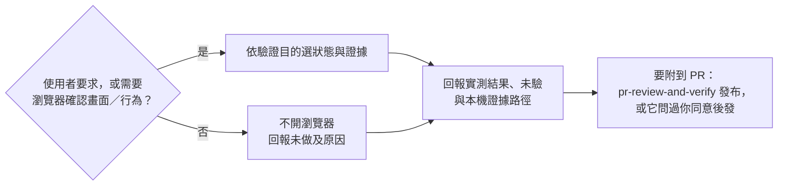

# verify-in-browser：需要時用瀏覽器驗收

使用者要求瀏覽器驗收，或 agent 判斷需要透過畫面／操作確認時，用手上能操作瀏覽器的工具驗證。
skill 規定的是驗多少、證據與回報。agent-runner 的驗收 run（AFK）只用
[`playwright-cli`](https://github.com/microsoft/playwright-cli)（headless，截圖、錄 webm）；
你在旁邊時，Claude Code 的 [Claude in Chrome](https://code.claude.com/docs/en/chrome)（`claude --chrome`，錄 GIF）、
Codex app 內建瀏覽器（截圖）也能照著做完，這些只有互動時才有的分支寫在
[`skills/verify-in-browser/hitl.md`](../../skills/verify-in-browser/hitl.md)。偏好能錄影的；只能截圖時，過程類斷言改連續截圖並註明「無錄影」。
一般 UI 改動不會自動要求瀏覽器驗收；依驗證目的選擇狀態與證據，回報實際結果及未驗項目。

這項觸發與證據原則的研究脈絡及來源限制，見[瀏覽器驗收政策研究記錄](browser-verification-research.md)；分類表是曾考慮的建議，未採用為固定政策。

工具怎麼分工的決定在 dotfiles 的
[ADR 0001](https://github.com/henry5720/dotfiles/blob/main/docs/adr/0001-browser-tools-drive-vs-debug.md)，
調查與 token 實測在
[docs/research/agent-browser-tools.md](https://github.com/henry5720/dotfiles/blob/main/docs/research/agent-browser-tools.md)。

## 為什麼這樣分

| 要做的事 | 用什麼 | skill |
|---|---|---|
| 需要時操作頁面驗證 | 手上的瀏覽器工具（偏好能錄影的 `playwright-cli`、Claude in Chrome） | `verify-in-browser`（自己寫的）＋ 該工具的文件；用 `playwright-cli` 時另有 `playwright-cli`（官方） |
| 查原因：慢、記憶體、minify 過的錯誤 | chrome-devtools MCP（有設定時） | [`remote-chrome`](remote-chrome.md) |
| 你要看著 agent 操作、或要用你桌機的登入狀態 | Claude in Chrome；或 `playwright-cli attach --cdp` 接 `remote-chrome` 開的桌機 Chrome（有設定時，能錄影） | — ／ [`remote-chrome`](remote-chrome.md) |
| 值得防回歸的流程 | 寫成該 repo 的 Playwright e2e | — |

官方的 `playwright-cli` 是第三方（`.metadata.json` 記來源），`update` 會蓋掉，所以驗收的規矩另外寫成
`verify-in-browser`，不併進去。`playwright-cli` 用 `open` 自己開的瀏覽器走 pipe，不佔 9222，跟
`remote-chrome`／`remote-chrome-headless` 可以同時開；要用 9222 那台時改 `attach --cdp=http://127.0.0.1:9222`。`remote-chrome` 是這台機器的設定，
同事多半沒有，所以 skill 只把它寫成「有設定時」的選項。

## 什麼時候驗、證據放哪



- 互動 session 和 agent-runner 走同一套主幹（驗多少、證據、逐條判定 JSON）；換工具、請你代登入、問你要不要發 PR comment 只在互動時發生（[hitl.md](../../skills/verify-in-browser/hitl.md)）。互動時你說「不用驗」它就跳過；agent 也不會因為改了 UI 就自動啟動驗收。
- 整套回歸交給 CI 和 e2e；選擇瀏覽器驗收時，只做足以回答驗證目的的操作，不要求走遍所有狀態或每個狀態都截圖。
- 截圖、錄影先存在本機暫存資料夾（`$CLAUDE_JOB_DIR/tmp/verify-<session>` 或 `/tmp/verify-<session>`）。
- 要附到 PR 時，由 `pr-review-and-verify` 依 reviewer 需要挑選、遮蔽秘密後上傳；沒走那支 skill 時，分支有 PR 它會問你一次要不要發成 comment，你同意才發。說明圖不代表已實際驗證，未驗項目照實列出。
- 改前截圖只在修 bug（issue 有 `bug` label 或分支 commit 是 `fix`；證明 bug 重現過）或你要求時必拍；改既有畫面用 PR body 文字寫改前，順手拿得到才拍；新功能不拍。要拍時先找 base 的線上部署（能證明部署內容等於改前、頁面開得到），不行才在本機開 base；都拿不到要寫原因。
- 開瀏覽器前先確認後端版本：PR 寫了依賴的後端 commit 就用 `git merge-base --is-ancestor` 檢查，沒寫才看 openapi 欄位。
- 「每個 PR 都寫驗證段」這條是全域規則，寫在這個 repo 的 `instructions/agents-md/AGENTS.md`（部署成 `~/.claude/CLAUDE.md`），不是這支 skill。

## 你要做的事

| 什麼時候 | 做什麼 |
|---|---|
| 新機器 | 備一個能操作瀏覽器的工具。這台用 `playwright-cli`：dotfiles chezmoi 選裝工具勾它（用 `headless-chrome` 裝的 Chrome），或 `npm i -g @playwright/cli`；WSL、ARM 不裝。Claude in Chrome 不支援 WSL。都沒有時 agent 把驗收列進「未驗」 |
| 要把驗收影片發到 PR | 裝 `ffmpeg`（要有 `libx264`）：`playwright-cli` 錄的 `.webm` 會照 `compress-video` 轉成 H.264 mp4。沒裝就附原 `.webm`，回報會註明 Safari 可能播不出；GIF 不用轉 |
| 升級 `@playwright/cli` 後 | 官方 skill 釘在跟 CLI 同一版的 commit，要手動跟（見下方） |
| 要 agent 驗需要登入的頁面 | 確認帳密在環境變數或那個 repo e2e 用的 `.env` 裡（agent 先看環境變數，只讀它要的那個 key） |

### 升級 playwright-cli 後跟上 skill

skill 釘在 `microsoft/playwright-cli` 的某個 commit（`.metadata.json` 的 `branch`），跟本機 CLI 同版，
跟 herdr 一樣，避免 skill 寫的指令 CLI 沒有。上游沒打 `v0.1.x` tag，所以釘 commit：找
`chore: mark v<新版>` 那顆。

```bash
playwright-cli --version
gh api 'repos/microsoft/playwright-cli/commits?per_page=20' --jq '.[] | .sha[:12] + " " + (.commit.message | split("\n")[0])' | grep 'mark v'
skillshare install https://github.com/microsoft/playwright-cli.git/skills/playwright-cli --branch <commit> --force && skillshare sync
```

裝好的 skill 應該跟 npm 套件裡帶的一字不差：

```bash
diff -r ~/.config/skillshare/skills/playwright-cli \
  "$(npm root -g)/@playwright/cli/node_modules/playwright-core/lib/tools/skills/playwright-cli"
```

`playwright-cli install --skills` 也能裝，但它寫進當下專案的 `.claude/skills/`，只有 Claude Code
看得到、也不記來源，所以改由 skillshare 裝。

換版後回頭看 `skills/verify-in-browser/playwright-cli.md` 裡寫著版本號的句子：裸 `snapshot` 印進對話、
`fill` 不加 `--raw` 印出明文、填完密碼後自動存的 snapshot 含明文。新版行為變了就改那幾句和版本號。
